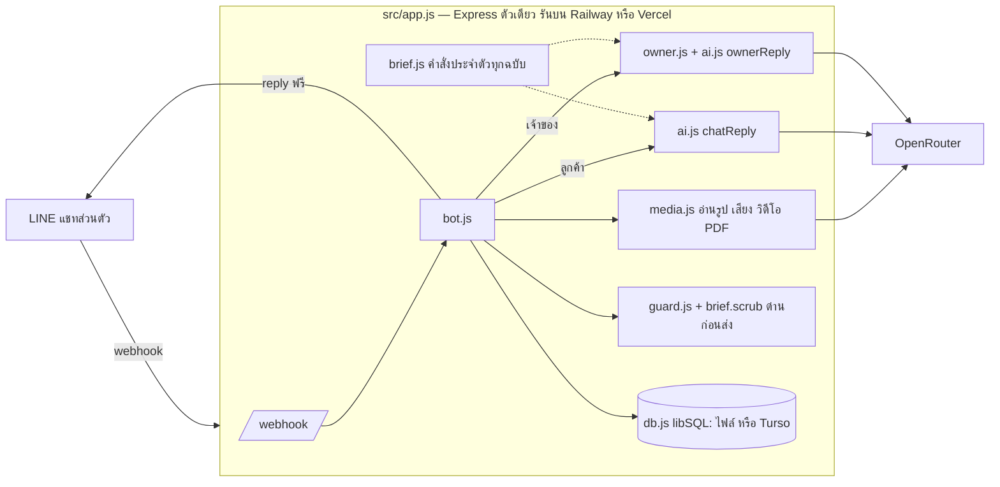
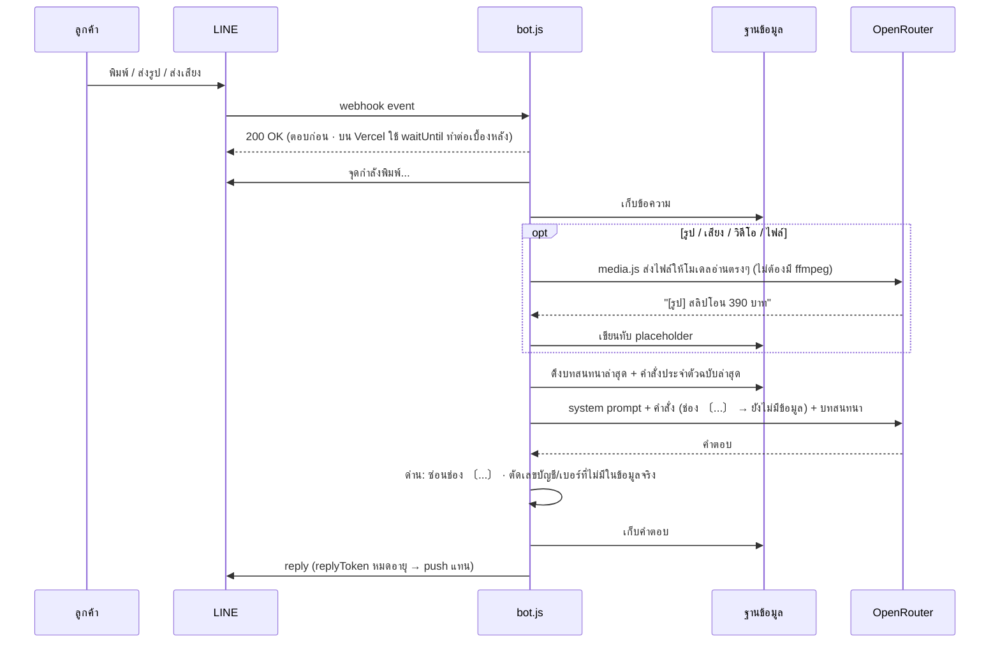
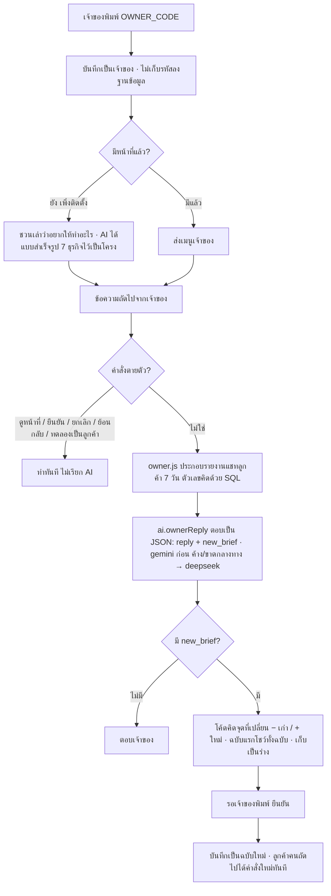

# การทำงานของระบบ

เอกสารนี้อธิบายว่าข้อความไหลยังไง ตั้งแต่มีคนทักบอทในแชทส่วนตัว จนบอทตอบกลับ — ทั้งฝั่งลูกค้าและโหมดเจ้าของ

## ภาพรวม

## ข้อความจากลูกค้าหนึ่งข้อความ

## โหมดเจ้าของ

- เจ้าของไม่นับเป็นลูกค้าในรายงาน · ไม่โดน `DAILY_LIMIT`
- ความจำโหมดเจ้าของ (`lane = owner`) แยกจากแชทแบบลูกค้า (`lane = chat`)
- ร่างที่ค้างเกิน 24 ชม. หมดอายุเอง · ระหว่างยังไม่ยืนยัน สั่งแก้ต่อได้เรื่อยๆ (AI แก้ต่อจากร่าง ไม่เริ่มใหม่)
- ยังไม่มีหน้าที่ ลูกค้าทักมาบอทยังทักทายได้ แต่เรื่องของร้านจะบอกว่ายังไม่มีข้อมูล ไม่เดา

## event ที่บอทรับ

| event | บอททำอะไร |
|---|---|
| แอดเพื่อน (`follow`) | จำชื่อจากโปรไฟล์ แล้วทักทาย (`BOT_GREETING`) |
| ข้อความ / สื่อ จากลูกค้า | เก็บ → อ่านสื่อ → AI ตอบ → ผ่านด่าน → ส่ง |
| ข้อความจากเจ้าของ | คำสั่งตายตัว หรือ AI โหมดเจ้าของ |
| ยกเลิกข้อความ (`unsend`) | ลบข้อความนั้นออกจากความจำ |
| ถูกเชิญเข้ากลุ่ม / มีข้อความในกลุ่ม | บอกสั้นๆ ว่าคุยได้เฉพาะแชทส่วนตัว แล้วออก |
| ครบ `DAILY_LIMIT` ของวันนั้น | ตอบสั้นๆ ว่าครบแล้ว ไม่เรียก AI |

## คำสั่งประจำตัว — ทุกฉบับเก็บไว้

ตาราง `brief_versions` เก็บทุกฉบับ **ฉบับล่าสุด = ที่ใช้อยู่**

- ตอนบูต: `brief.txt` (หรือ `BOT_BRIEF`) ไม่ตรงกับฉบับไฟล์ล่าสุดที่จำไว้ → บันทึกเป็นฉบับใหม่ (คำสั่ง SQL เดียวแบบมีเงื่อนไข — Vercel บูตพร้อมกันหลายตัวก็ไม่ซ้ำ)
- เจ้าของ `ยืนยัน` ในแชท → บันทึกเป็นฉบับใหม่ (`source = chat`)
- `ย้อนกลับ` → ทิ้งฉบับล่าสุด
- ฝั่งลูกค้า: ช่อง `〔...〕` ที่ยังไม่กรอกถูกแทนด้วย "(ยังไม่มีข้อมูล)" — ทดสอบแล้ว ส่งช่องดิบไปโมเดลพิมพ์ให้ลูกค้าเห็น และถ้าตัดบรรทัดทิ้ง โมเดลแต่งเลขบัญชีปลอมขึ้นมาเอง

## ด่านก่อนส่งถึงลูกค้า

1. `brief.scrubPlaceholders` — ช่อง `〔...〕` หรือคำว่า (ยังไม่มีข้อมูล) ที่หลุดมา → "(ทางร้านจะแจ้งให้)" · บรรทัดที่หลุดหลายจุด → แทนทั้งบรรทัด
2. `guard.guardNumbers` — ตัวเลขยาว 6 หลักขึ้นไป (เลขบัญชี เบอร์โทร) ที่หาไม่เจอในคำสั่งประจำตัวหรือบทสนทนา → ตัดทิ้ง และลง log `[guard]`

## รันได้ 2 ที่

| | Railway / เครื่องตัวเอง | Vercel |
|---|---|---|
| ทางเข้า | `src/index.js` → `app.listen()` | `api/index.js` → ส่ง `app` ออก · `vercel.json` ส่งทุกที่อยู่มาที่นี่ |
| ฐานข้อมูล | ไฟล์ `chatbot.db` (`DB_PATH`) | Turso (`DATABASE_URL` + `DATABASE_AUTH_TOKEN`) |
| งานหลังตอบ LINE | รันต่อเองตามปกติ | `waitUntil` จาก `@vercel/functions` (ทดสอบบน Vercel จริงแล้ว ทำงานต่อจนจบ) |
| เวลาไทย | `TZ=Asia/Bangkok` | ห้ามตั้ง `TZ` — โค้ดคิดเวลาไทยเองอยู่แล้ว |
| สำรองข้อมูล | `/admin/backup` + `bin/backup-db.sh` | หน้าเว็บ Turso |
